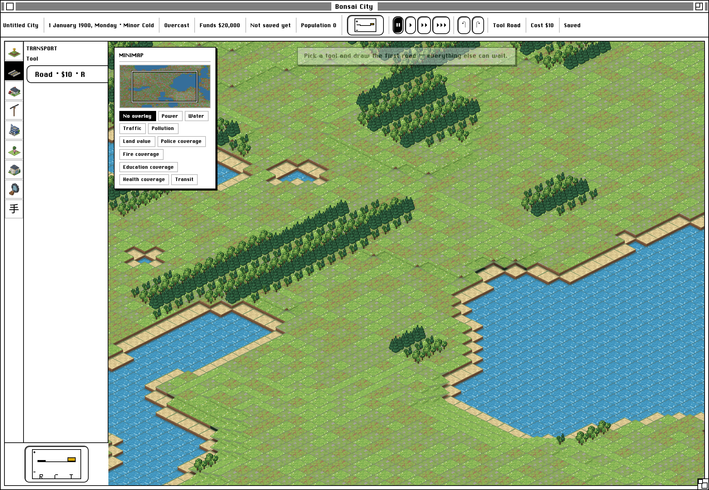
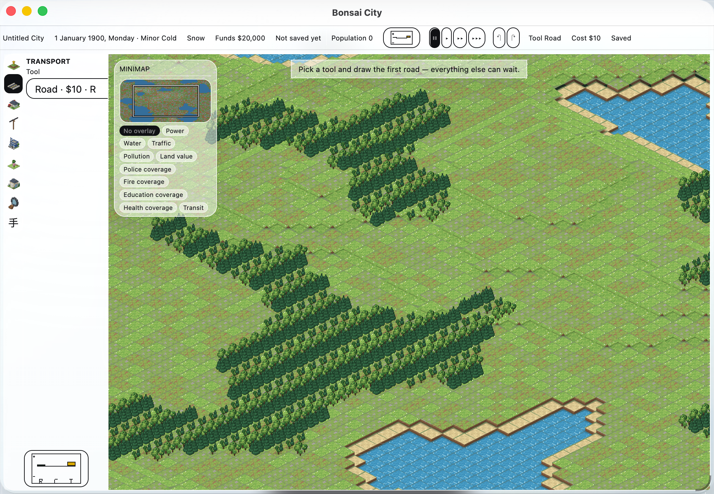
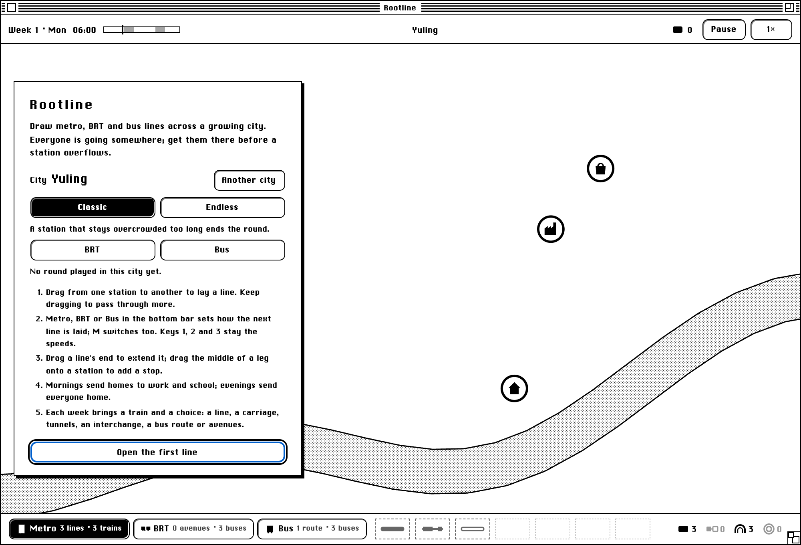
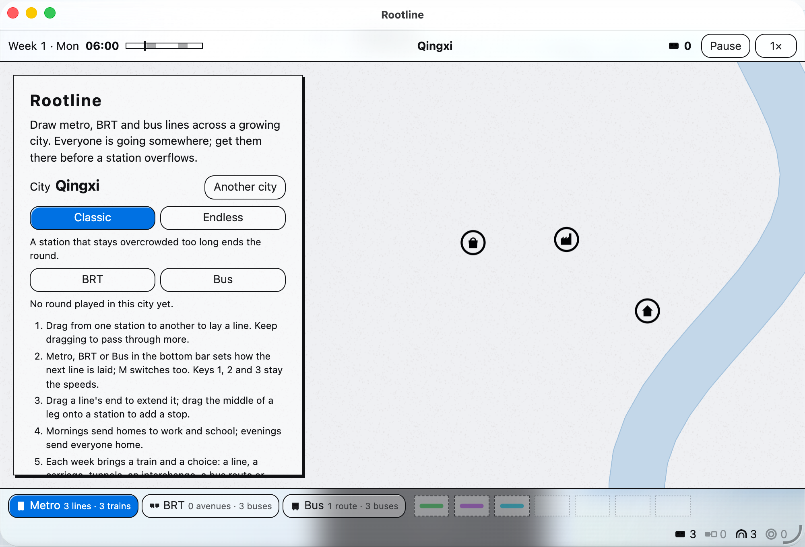
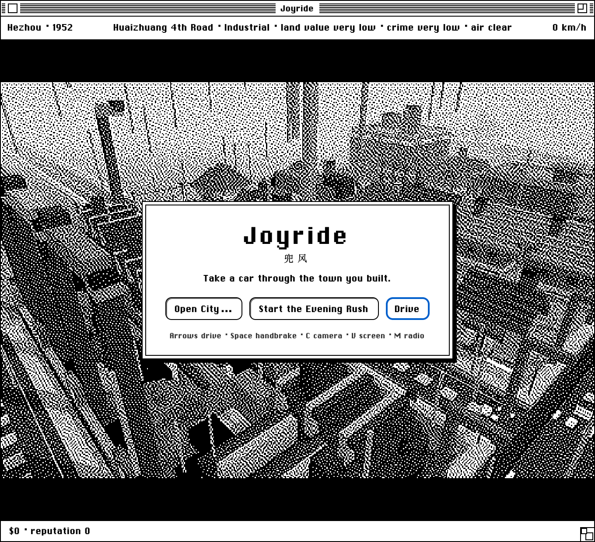
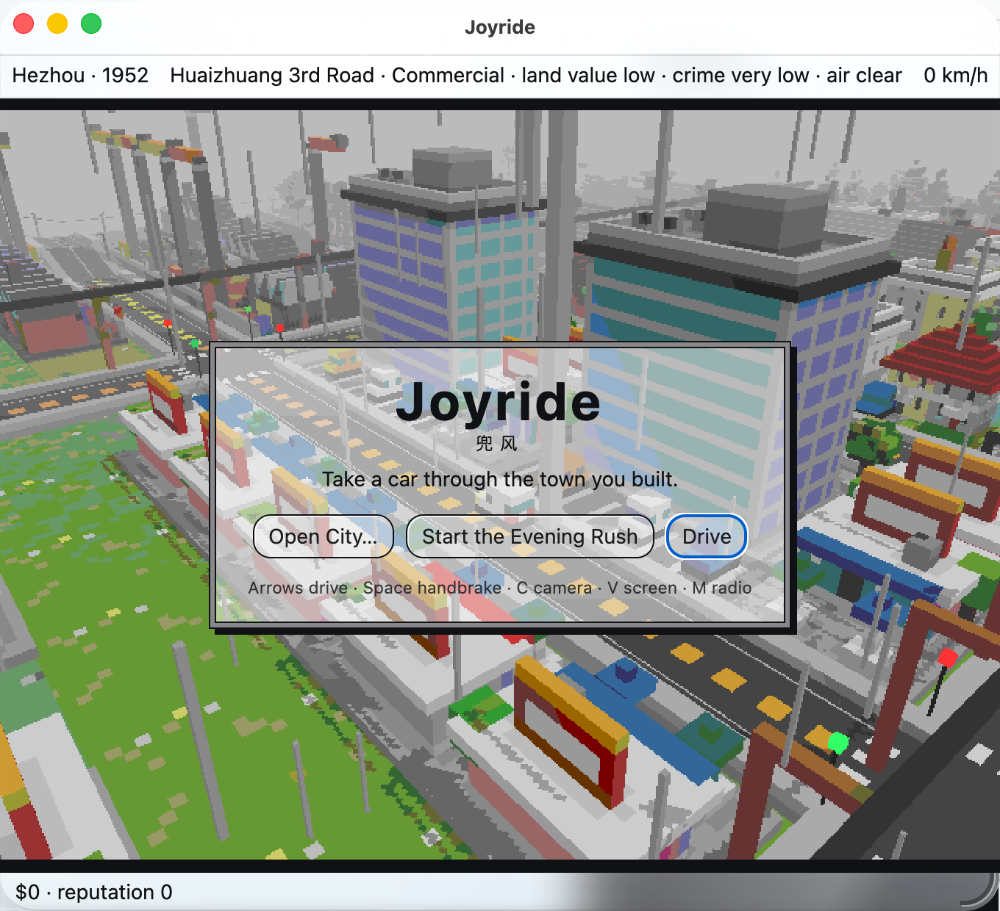

# Bonsai City

Three small browser games that share one city save.

## Screenshots

Captured running inside the AI System 6 desk: Classic on the left, Liquid Glass on the right.

**Bonsai City**

<p> </p>

**Rootline**

<p> </p>

**Joyride**

<p> </p>

- **Bonsai City** — an isometric city builder: zone land, lay power and water, grow buildings, and keep the town running.
- **Rootline** — draw metro, BRT and bus lines across a growing city; get people where they are going before a station overflows.
- **Joyride** — take a car through the town you built (synthesized radio; no sample bank).

Saved cities are held as bridge state. On a page with no host, `ais6-bridge.js` answers the same calls with its standalone adapter (local storage–backed state, per that file’s header).

## Play on its own page

```bash
npm start
```

Then open:

| Game | Address |
| --- | --- |
| Bonsai City | `http://localhost:8080/city/` |
| Rootline | `http://localhost:8080/rootline/` |
| Joyride | `http://localhost:8080/joyride/` |

Each page loads `ais6-bridge.js`, shared strings and runtime, and that game’s modules (`city/index.html`, `rootline/index.html`, `joyride/index.html` script lists).

## Build

```bash
npm run build
```

Copies what a host page embeds into `dist/`. There are no package dependencies; Node is enough. The sprite atlases, texture atlases, voxel model pack, and `vendor/bonsai-renderer.js` (a bundled three.js subset) are generated by tools in the AI System 6 repository and are shipped here as built files. This build does not regenerate them.

## Layout

| Path | What it is |
| --- | --- |
| `city/` | Bonsai City: the page, shell, Canvas renderer, stylesheet |
| `rootline/` | Rootline: the page, line-network game, view, stylesheet |
| `joyride/` | Joyride: the page, drive game, traffic, radio, stylesheet |
| `shared/` | Simulation, codecs, OSM mapper, render math, voxel renderer, strings, base styles, bridge runtime |
| `assets/` | Atlases, textures, voxel models, provenance, source-art plate |
| `vendor/` | Bundled three.js subset used by the voxel renderer |
| `ais6-bridge.js`, `kit.css`, `app.manifest.json` | Let a host page embed the games in frames, keep shared city state and draw their menus; on their own page the same calls fall back to the bridge’s standalone adapter |
| `tools/build.mjs` | Copies the embed tree into `dist/` |

## Embedding

A host needs the same-origin embed tree (everything `npm run build` puts in `dist/`), served so each game’s `index.html` can load relative scripts and assets. The bridge (`ais6-bridge.js`) and the window list in `app.manifest.json` are how the host opens each game in a frame, keeps progress, and draws menus. Kit styles come from `kit.css`.

## Licence

MIT. See [LICENSE](LICENSE); file by file: [LICENSES.md](LICENSES.md).

The material plate `assets/source-art/city-materials-v1.png` was generated with
an AI image tool for this project (the generating model was not recorded); it
ships under the same licence. The readers and writers of classic city files
carry format facts only; thanks to the public format notes they were learned
from, among them SC2k-docs (CC BY-SA 4.0).

中文说明见 [README.zh-CN.md](README.zh-CN.md).
